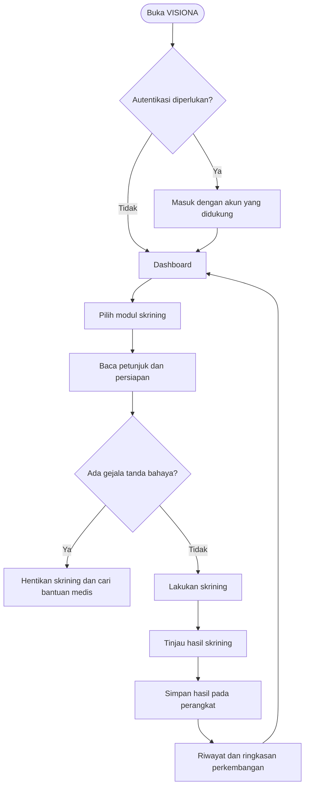

  

VISIONA
  Vision Assessment & Eye Health Screening System

  Aplikasi desktop untuk skrining mandiri kesehatan penglihatan.

  Dikembangkan oleh Xodetech · Pencipta: Zakky Mubaraq
   
  

Tentang VISIONA
VISIONA adalah aplikasi desktop yang membantu pengguna melakukan skrining awal penglihatan secara mandiri, meninjau hasil, dan melihat riwayat pemeriksaan mereka. Antarmuka dirancang agar proses skrining terasa jelas, terarah, dan mudah diikuti.
Catatan medis: VISIONA merupakan alat skrining awal, bukan alat diagnosis, surat keterangan medis, atau pengganti pemeriksaan oleh tenaga kesehatan profesional. Hasil skrining tidak memastikan ada atau tidaknya suatu penyakit mata.

Fitur utama
- Delapan modul skrining untuk beberapa aspek penglihatan.
- Hasil dan riwayat pribadi agar pengguna dapat meninjau pemeriksaan sebelumnya.
- Ringkasan perkembangan berdasarkan data pemeriksaan yang tersimpan.
- Penyimpanan lokal untuk data skrining pada komputer yang digunakan; data tidak otomatis tersinkron ke komputer lain.
- Antarmuka desktop yang ditujukan untuk penggunaan personal.
Modul skrining
Modul	Tujuan umum
Kuesioner Gejala	Mengumpulkan informasi awal mengenai gejala yang dirasakan.
Ketajaman Visual	Menilai ketajaman penglihatan secara digital pada mata kanan dan kiri.
Penglihatan Warna	Melakukan skrining awal kemampuan membedakan warna.
Astigmatisme	Mengamati kemungkinan pola penglihatan yang berkaitan dengan astigmatisme.
Sensitivitas Kontras	Menilai kemampuan mengenali perbedaan kontras.
Lapang Pandang Sederhana	Melakukan pemeriksaan awal pada area penglihatan.
Penglihatan Dekat	Melakukan skrining kemampuan melihat objek pada jarak dekat.
Grid Amsler	Membantu mengamati distorsi pada pola kisi saat dilihat satu mata secara bergantian.

Hasil setiap modul dipengaruhi oleh kondisi penggunaan, termasuk layar, resolusi dan skala tampilan, pencahayaan, jarak pandang, serta kondisi pengguna.
Alur aplikasi
Diagram berikut menunjukkan alur umum penggunaan VISIONA.

Privasi dan penyimpanan data
- Riwayat skrining dan preferensi lokal disimpan pada perangkat tempat aplikasi digunakan.
- Data lokal tidak otomatis tersedia di komputer lain.
- Jangan menggunakan perangkat bersama tanpa mengamankan sesi dan akses ke profil pribadi.
- Untuk ketentuan lengkap, baca [Kebijakan Privasi](gh-pages/privacy.html) dan [Syarat & Ketentuan](gh-pages/terms.html).
Detail implementasi autentikasi dan penyimpanan mengikuti versi aplikasi yang didistribusikan. Jangan memasukkan kata sandi Google ke dalam aplikasi atau membagikan data kesehatan pribadi kepada pihak lain.
Teknologi
VISIONA dikembangkan sebagai aplikasi desktop dengan antarmuka web modern dan runtime aplikasi berbasis Electron. Komponen backend, runtime, serta penyimpanan yang dibundel dapat berbeda sesuai paket rilis. Distribusi final harus diuji sebagai aplikasi mandiri dan tidak boleh mengharuskan pengguna akhir memasang Laragon atau mengonfigurasi basis data secara manual.
Unduhan
Periksa halaman GitHub Releases untuk melihat paket yang benar-benar telah diterbitkan.
- Windows: gunakan installer atau paket portabel yang tercantum pada rilis resmi.
- macOS: paket DMG untuk Intel dan Apple Silicon hanya dapat dianggap tersedia setelah berkas rilis dipublikasikan dan diuji pada perangkat/runner macOS yang sesuai.
Jika belum ada berkas rilis untuk platform tertentu, berarti paket tersebut belum tersedia untuk diunduh.
Menjalankan website publik secara lokal
Website informasi VISIONA berada di direktori gh-pages/ dan dapat dibuka langsung melalui index.html.
gh-pages/
├── index.html
├── privacy.html
├── terms.html
└── assets/
    ├── css/style.css
    ├── images/
    └── js/main.js
Untuk mengujinya menggunakan server PHP lokal (opsional):
cd C:\laragon\www\visiona\gh-pages
php -S localhost:8080
Kemudian buka http://localhost:8080 pada browser.
Distribusi dan situs resmi
- Repositori: Chaxyzzz/Visiona
- Releases: Unduhan aplikasi
- Website GitHub Pages: Buka website VISIONA
Status tautan publik dan aset unduhan mengikuti konfigurasi serta rilis terbaru di GitHub.
Batasan penggunaan
Skrining digital tidak menggantikan pemeriksaan mata secara langsung. Akurasi dapat dipengaruhi oleh ukuran dan resolusi layar, pembesaran tampilan, kalibrasi warna, pencahayaan, jarak pengguna dari layar, serta cara pengujian dilakukan.

Apabila mengalami kehilangan penglihatan mendadak, nyeri mata berat, cedera mata, atau perubahan penglihatan yang tiba-tiba, jangan menunda untuk mencari pertolongan medis segera.

  **VISIONA** · Vision Assessment & Eye Health Screening System  
  Built with care by **Xodetech**

