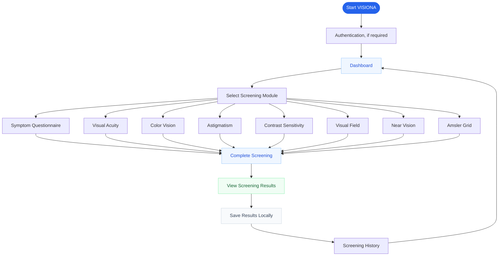

<div align="center">


# VISIONA

### Vision Assessment & Eye Health Screening System

**A Desktop-Based Digital Eye Health Screening Application**

Aplikasi desktop untuk skrining mandiri kesehatan mata, membantu pengguna mengenali kondisi penglihatan awal melalui serangkaian pemeriksaan digital, melihat hasil, serta meninjau riwayat skrining secara terstruktur.

<br>

[](#platform-support)
[](#)
[](#credits)
[](#medical-disclaimer)

**Technology, thoughtfully built.**

</div>

---

## Overview

VISIONA merupakan aplikasi desktop yang dikembangkan oleh **Xodetech** untuk menyediakan pengalaman skrining kesehatan mata secara mandiri melalui komputer.

Aplikasi ini menggabungkan pemeriksaan penglihatan digital, penyajian hasil, riwayat pemeriksaan, dan pemantauan hasil sebelumnya dalam satu lingkungan aplikasi.

### Key Features

| Feature | Description |
|---|---|
| **Eye Screening** | Delapan modul pemeriksaan penglihatan digital. |
| **Screening Results** | Menampilkan hasil dari pemeriksaan yang telah diselesaikan. |
| **Screening History** | Membantu pengguna meninjau pemeriksaan sebelumnya. |
| **Progress Monitoring** | Memudahkan perbandingan hasil skrining dari waktu ke waktu. |
| **Personal Profile** | Pengelolaan profil dan preferensi pengguna. |
| **Educational Resources** | Informasi mengenai kesehatan mata dan keterbatasan skrining digital. |
| **Desktop Experience** | Antarmuka yang dirancang untuk penggunaan pada komputer. |

---

## Application Preview

<div align="center">


*Antarmuka modul skrining VISIONA.*

</div>

---

## Screening Modules

VISIONA menyediakan delapan modul skrining penglihatan digital.

<table>
<tr>
<td width="50%" valign="top">

### 01 — Symptom Questionnaire

Kuesioner untuk membantu pengguna mengenali dan mencatat gejala terkait penglihatan.

### 02 — Visual Acuity

Pemeriksaan ketajaman penglihatan mata kanan dan kiri secara terpisah.

### 03 — Color Vision

Skrining kemampuan membedakan warna melalui pengujian visual.

### 04 — Astigmatism

Pemeriksaan awal untuk mengidentifikasi pola penglihatan yang mungkin berkaitan dengan astigmatisme.

</td>
<td width="50%" valign="top">

### 05 — Contrast Sensitivity

Skrining kemampuan membedakan objek berdasarkan perbedaan kontras.

### 06 — Visual Field

Pemeriksaan sederhana untuk mengeksplorasi persepsi area penglihatan.

### 07 — Near Vision

Skrining kemampuan melihat objek pada jarak dekat.

### 08 — Amsler Grid

Pemeriksaan menggunakan kisi Amsler untuk membantu mengenali perubahan persepsi garis atau pola visual.

</td>
</tr>
</table>

> **Important:** Seluruh modul merupakan alat skrining digital. Hasilnya bukan diagnosis medis dan tidak menggantikan pemeriksaan oleh dokter mata.

---

## Application Workflow

Diagram berikut menggambarkan alur utama penggunaan VISIONA.



*Diagram ini merupakan gambaran konseptual alur aplikasi. Autentikasi, penyimpanan, dan navigasi mengikuti implementasi aktual pada versi aplikasi yang digunakan.*

---

## Platform Support

| Platform | Availability |
|---|---|
| **Windows 10 / 11 — 64-bit** | Ikuti ketersediaan paket installer pada bagian distribusi. |
| **macOS — Intel & Apple Silicon** | Paket harus tersedia dan tervalidasi sebelum dapat diunduh. |
| **Linux** | Tidak termasuk platform target resmi. |

### Download

Kunjungi halaman distribusi resmi VISIONA untuk memeriksa paket yang tersedia.

**Website:** `https://chaxyzzz.github.io/Visiona/`

> Ketersediaan unduhan bergantung pada paket rilis yang benar-benar telah dipublikasikan. Jangan menganggap suatu platform tersedia hanya karena tercantum pada tabel.

---

## Privacy & Data Handling

VISIONA dirancang sebagai aplikasi desktop mandiri dengan fokus pada data pribadi pengguna.

Prinsip pengelolaan data yang dituju meliputi:

- Hasil skrining dan riwayat pemeriksaan disimpan secara lokal pada komputer pengguna.
- Data setiap pengguna harus dibatasi sesuai mekanisme autentikasi dan kepemilikan data yang diterapkan.
- Informasi akun digunakan sesuai kebutuhan autentikasi aplikasi.
- Pengguna perlu memahami lokasi penyimpanan data sebelum menghapus aplikasi atau memindahkan komputer.

Baca dokumen resmi berikut untuk mengetahui kebijakan dan ketentuan yang berlaku:

- [Privacy Policy](gh-pages/privacy.html)
- [Terms & Conditions](gh-pages/terms.html)

*Penjelasan ini merangkum rancangan privasi aplikasi. Detail penyimpanan dan pemrosesan data harus mengikuti implementasi aktual serta isi dokumen kebijakan yang dipublikasikan.*

---

## Technology

VISIONA menggunakan teknologi aplikasi desktop dan komponen pendukung sesuai implementasi proyek.

| Component | Technology |
|---|---|
| Desktop runtime | Electron |
| Application interface | HTML, CSS, JavaScript |
| Backend | PHP |
| Local database | SQLite |
| Packaging | Electron Builder |

*Daftar ini menjelaskan teknologi yang digunakan dalam rancangan proyek. Konfigurasi dan versi dependensi dapat berbeda menurut build.*

---

## Medical Disclaimer

VISIONA dikembangkan untuk mendukung skrining awal kesehatan mata, bukan untuk menetapkan diagnosis atau menggantikan konsultasi medis.

- Hasil skrining tidak memastikan ada atau tidaknya suatu penyakit mata.
- Akurasi pemeriksaan digital dapat dipengaruhi ukuran dan resolusi layar, skala tampilan, pencahayaan, jarak pengamatan, serta kondisi perangkat.
- Hasil normal tidak menjamin bahwa mata sepenuhnya sehat.
- Keluhan yang menetap atau hasil yang mengkhawatirkan perlu dikonsultasikan kepada tenaga medis profesional.
- Kehilangan penglihatan secara mendadak, nyeri mata berat, atau perubahan penglihatan mendadak memerlukan pertolongan medis segera.

**Gunakan VISIONA sebagai sarana skrining dan edukasi, bukan sebagai pengganti pemeriksaan profesional.**

---

## Project Structure

Struktur ringkas direktori website publik VISIONA:

```text
visiona/
├── gh-pages/
│   ├── assets/
│   │   ├── css/
│   │   │   └── style.css
│   │   ├── images/
│   │   │   ├── visiona-logo-dark.png
│   │   │   ├── app-screenings-preview.png
│   │   │   └── favicon.ico
│   │   └── js/
│   │       └── main.js
│   ├── index.html
│   ├── privacy.html
│   ├── terms.html
│   └── README.md
│
├── dist/
│   └── Application release artifacts
│
└── README.md
```

*Struktur di atas merupakan ilustrasi. Pastikan lokasi file sesuai dengan struktur repositori yang sebenarnya.*

---

## Credits

<div align="center">

**VISIONA**

Vision Assessment & Eye Health Screening System

Developed by **Xodetech**

Creator: **Zakky Mubaraq**

[Official Website](https://chaxyzzz.github.io/Visiona/) · [GitHub Repository](https://github.com/Chaxyzzz/Visiona)

<br>

*Technology, thoughtfully built.*

</div>
